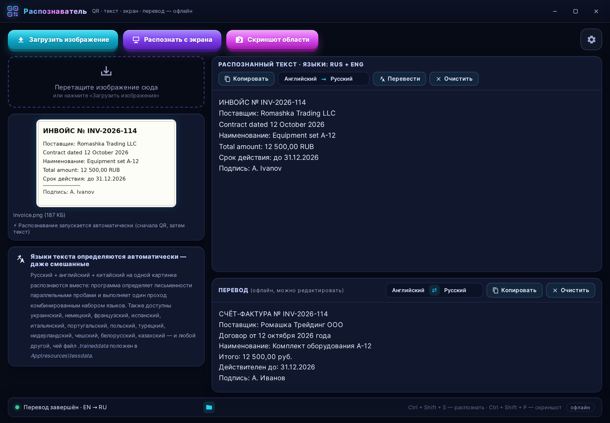
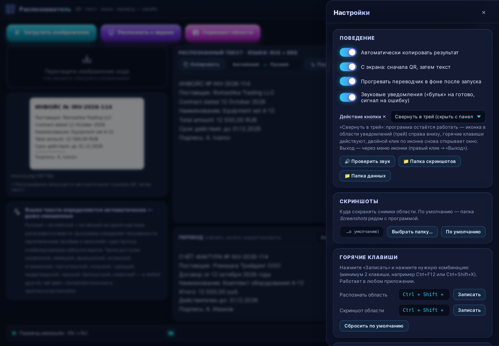

# «Распознаватель» — портативная офлайн-программа для Windows

**Распознаватель** — бесплатная портативная программа для Windows 10/11 (x64),
которая распознаёт текст и QR/штрих-коды с экрана и изображений, делает
скриншоты области экрана и переводит текст между английским и русским —
**полностью офлайн**, без интернета, установки и прав администратора.

Текущая версия: **2.6.0**. Готовые файлы — на странице
[Releases](../../releases): установщик и портативная папка.



---

## Зачем она нужна

* Видите на экране текст, который нельзя выделить (видео, PDF-картинка,
  чужое приложение, скан в просмотрщике) — нажимаете **Ctrl+Shift+S**,
  выделяете область мышью и получаете текст в буфере обмена и в окне программы.
* Есть картинка или скан с текстом — перетащите файл в окно: текст распознается.
* На картинке QR или штрих-код (EAN, Code128 и др.) — он определится
  автоматически, тем же выделением области.
* Полученный текст можно сразу перевести EN↔RU офлайн или сохранить скриншот
  области экрана в папку (**Ctrl+Shift+P**).

Всё работает на вашем компьютере: никаких облаков, отправки изображений
в интернет и подписок.

---

## Возможности

| Область | Что умеет |
|---|---|
| **OCR (текст с картинок и экрана)** | 15 языков: русский, английский, украинский, немецкий, французский, испанский, итальянский, португальский, польский, чешский, нидерландский, турецкий, белорусский, казахский, китайский; смешанный текст (рус+англ) распознаётся за один проход; окно-лупа для мелких деталей (зум колесом, перетаскивание) |
| **QR и штрих-коды** | QR, EAN-13, Code128 и др. — автоматически при распознавании области или файла |
| **Перевод офлайн** | встроенные пакеты EN↔RU в обе стороны; «Авто» определяет язык текста; 60+ языков скачиваются одним нажатием и дальше работают офлайн; транзитные пары (например RU→DE) собираются цепочкой через английский |
| **Скриншоты** | выделение области экрана → автосохранение в настраиваемую папку; значок папки в статус-баре |
| **История** | все распознавания (текст и QR) сохраняются локально: время, источник, языки, уверенность; поиск, копирование, вставка в результат |
| **Трей и автозапуск** | жизнь в системном трее, автозапуск вместе с Windows свёрнутым; меню трея: «Показать/Скрыть окно», «Выход» |
| **Горячие клавиши** | глобальные, настраиваемые (любые комбинации от 2 клавиш) |
| **Настройки** | звуки-уведомления, действие кнопки ✕, папка скриншотов, горячие клавиши, автозапуск — всё сохраняется между запусками |



---

## Горячие клавиши

| Клавиши | Действие |
|---|---|
| **Ctrl+Shift+S** | Выделить область экрана → «умное» распознавание (сначала QR, затем текст) |
| **Ctrl+Shift+P** | Скриншот выделенной области (автосохранение в папку) |
| **Esc** (в режиме выделения) | Отмена |

Обе комбинации настраиваются: Настройки → «Горячие клавиши» → «Записать» →
нажмите любую комбинацию от 2 клавиш. Запись идёт по физическому коду
клавиши — русская раскладка не мешает. Системные комбинации
(Alt+F4, Win+L и т.п.) отклоняются.

---

## Установка и запуск

Нужна только **Windows 10 или 11 (64 бит)**. Интернет и права администратора
не требуются.

**Вариант 1 — установщик.** Скачайте `Raspoznavatel-2.6.0-Setup.exe`
со страницы [Releases](../../releases) и запустите. Установка в папку
пользователя (без админ-прав), ярлыки на рабочем столе и в «Пуске»,
удаление через «Установку и удаление программ».

**Вариант 2 — портативная папка.** Скачайте
`Raspoznavatel_v2.6.0_win64_portable.zip`, распакуйте в любое место
(хоть на флешку) и запускайте `Raspoznavatel\Raspoznavatel.exe`.
Установка не нужна; папку можно переносить целиком.

Программа хранит свои данные (историю, настройки, скриншоты) рядом с собой
или в папке пользователя — реестр Windows не используется.

---

## Что встроено внутрь программы

* Движок OCR **Tesseract** (портативный комплект) и словари 15 языков;
* движки QR/штрих-кодов **zxing-cpp** и **pyzbar**;
* модели офлайн-перевода **Argos (EN↔RU, оба направления)**;
* все библиотеки Python — программа самодостаточна и работает без интернета.

Все компоненты — открытое ПО с разрешительными лицензиями
(Apache-2.0, MIT, BSD, LGPL с предоставлением исходников upstream).

---

## Сборка из исходников

Нужны Windows 10/11 x64 и Python 3.11 (64 бит). Интернет — только на время
сборки (скачиваются зависимости и ресурсы).

```bat
:: способ 1: один двойной клик
build.bat

:: способ 2: вручную
python -m venv .venv
.venv\Scripts\activate
pip install -r requirements.txt
python tools\download_resources.py
pyinstaller build.spec --noconfirm --clean
:: итог: dist\Raspoznavatel\Raspoznavatel.exe (портативная папка)
```

Установщик собирается из готовой папки: `makensis installer.nsi`
(NSIS) → `dist\Raspoznavatel-2.6.0-Setup.exe`.

Сборка возможна и в Linux через Wine (так собраны официальные релизы):
Wine 8+, Windows-Python 3.11 в префиксе (`C:\winpy`), затем
`wine C:\winpy\python.exe -m pip install -r requirements.txt` и
`wine C:\winpy\python.exe -m PyInstaller build.spec --noconfirm --clean`.

### Самодиагностика сборки

```bat
set RASPOZ_SELFTEST=1
Raspoznavatel.exe
```

Отчёт проверяет встроенные компоненты: Tesseract, OCR, движки QR,
офлайн-перевод, tkinter и захват экрана.

---

## Структура проекта

| Файл | Назначение |
|---|---|
| `main.py` | точка входа: окно pywebview, трей, горячие клавиши |
| `api.py` | мост «интерфейс ↔ Python»: распознавание, перевод, настройки, история |
| `ocr.py` | OCR: предобработка, турнир движков, смешанные языки |
| `qr_reader.py` | QR и штрих-коды |
| `translator.py` | офлайн-перевод (ctranslate2 + sentencepiece, модели Argos) |
| `screen_capture.py` | захват области экрана, окно-лупа |
| `tray.py` | иконка в системном трее (чистый ctypes) |
| `config.py`, `log.py`, `proc.py` | пути/настройки, журнал, запуск процессов без консоли |
| `ui/` | интерфейс (HTML/CSS/JS внутри нативного окна pywebview) |
| `resources/` | словари OCR, движок Tesseract, модели перевода |
| `tests/` | юнит-тесты логики, UI-тесты, E2E-проверки |

---

## Проверки

Логика покрыта юнит-тестами (`tests/test_logic.py`, запускаются без Windows),
интерфейс — headless-тестами (`tests/ui_test.py`), сценарии «как пользователь» —
E2E (`tests/capture_e2e.py`), готовые сборки — самодиагностикой и тихой
установкой. Журнал прогона тестов каждой версии хранится в истории коммитов.
